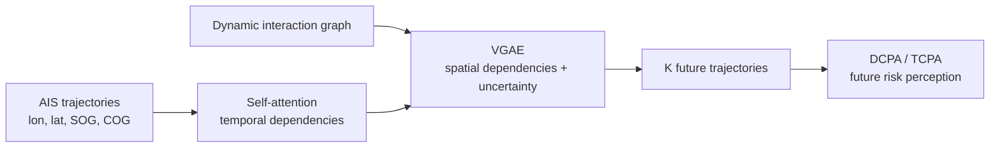
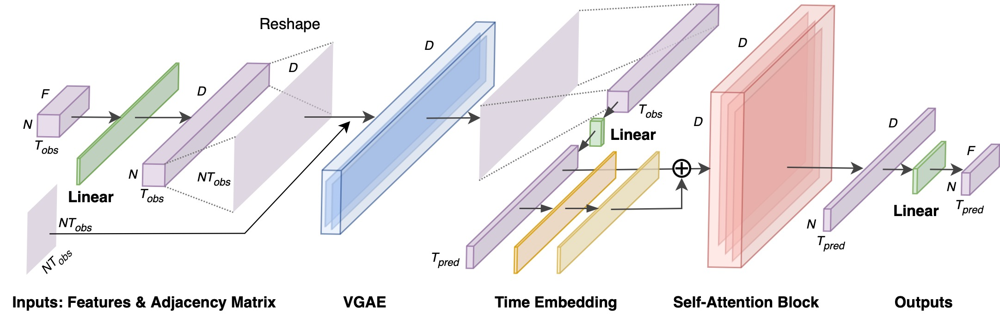
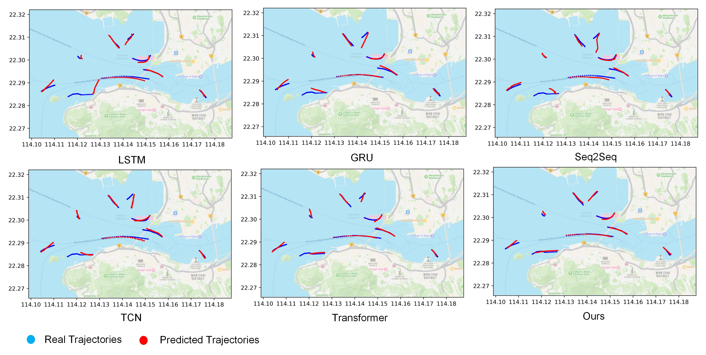

# GLRP: Interaction-Aware Graph Learning for Multi-Ship Risk Perception

<p align="center">
  <a href="https://doi.org/10.1016/j.ress.2025.111150"></a>
  <a href="https://doi.org/10.1016/j.ress.2025.111150"></a>
  
  
  <a href="License"></a>
</p>

Official PyTorch implementation of **“Enhancing Risk Perception by Integrating Ship Interactions in Multi-Ship Encounters: A Graph-Based Learning Method”**, published in *Reliability Engineering & System Safety* (2025).

**GLRP** connects multi-ship interaction modeling, probabilistic trajectory prediction, and future collision-risk perception in one pipeline. Given AIS trajectories and time-varying ship-interaction graphs, it predicts multiple plausible future motions and derives ship-to-ship **DCPA** and **TCPA** for safer, interaction-aware navigation decisions.

[[Paper](https://doi.org/10.1016/j.ress.2025.111150)] [[ScienceDirect](https://www.sciencedirect.com/science/article/pii/S0951832025003515)] [[AIS preprocessing](https://github.com/KaysenWB/AIS-Process)] [[Citation](#citation)]

## Why GLRP?

Sequence models can learn how an individual ship moves, but they do not explicitly explain how nearby ships alter one another's future actions. This limitation is especially important in dense or crossing traffic, where a small trajectory error can lead to a misleading assessment of future collision risk.

GLRP addresses this gap through four components:

- **Global temporal modeling:** a self-attention encoder learns long-range dependencies in each observed trajectory.
- **Interaction-aware spatial modeling:** a two-layer graph convolutional encoder exchanges information between nearby ships.
- **Uncertainty-aware prediction:** a variational graph auto-encoder (VGAE) samples latent interaction responses and generates multiple plausible futures.
- **Risk-oriented output:** predicted longitude, latitude, speed over ground (SOG), and course over ground (COG) are converted into future DCPA/TCPA risk indicators.



## Network architecture

<p align="center">
  
</p>

The observed trajectories first enter the self-attention block. Features from the final observed timestep are then passed to a VGAE, where two graph-convolution layers model ship interactions and variational inference represents uncertain responses. The latent space is sampled `K` times and decoded autoregressively with a GRU cell. The resulting trajectories support future DCPA/TCPA analysis.

For the default setting:

- Input trajectories: `[T_obs, N, 4]`
- Input adjacency matrices: `[T_obs, N, N]`
- GLRP predictions: `[T_pred, N, K, 4]`
- Risk outputs: `[T_pred, N, N]`
- Features: longitude, latitude, SOG, and COG
- Number of sampled futures: `K = 30`

## Main results

On multi-ship encounters from Victoria Harbour, GLRP achieved the best ADE/FDE across all four prediction horizons compared with LSTM, GRU, Seq2Seq, TCN, and Transformer baselines.

| Prediction horizon | GLRP ADE | GLRP FDE | Best baseline ADE | Best baseline FDE |
|---:|---:|---:|---:|---:|
| 16 steps | **0.0358** | **0.0654** | 0.0436 | 0.0727 |
| 32 steps | **0.0709** | **0.1343** | 0.0791 | 0.1416 |
| 48 steps | **0.1050** | **0.1993** | 0.1110 | 0.2046 |
| 64 steps | **0.1393** | **0.2704** | 0.1460 | 0.2723 |

More importantly, interaction-aware prediction improves downstream risk perception. Compared with the average of the five individual sequence models, GLRP reduced the normalized perception error by:

- **5.45% for DCPA**
- **4.85% for TCPA**

These reductions are measured relative to the corresponding spatial and temporal perception ranges reported in the paper.

<p align="center">
  
</p>

Qualitative comparison for a 32-observation/32-prediction-step multi-ship encounter. GLRP provides more stable and accurate predictions, particularly around crossing areas.

## Repository structure

```text
RESS_GLRP/
├── README.md
├── License
├── D_TCPA.py                  # DCPA/TCPA calculation and risk-analysis utilities
├── Figures/
│   ├── Figure03.jpg           # GLRP architecture
│   └── Figure08.jpeg          # Qualitative trajectory results
└── RESS_GLRP/
    ├── main_run.py            # Main training, testing, and prediction entry point
    ├── processor.py           # Training/test loops, checkpoints, and prediction export
    ├── dataloader.py          # Processed AIS dataset loading and normalization
    ├── GLRP.py                # GLRP, VGAE, graph encoder, and trajectory decoder
    ├── Compared_models.py     # LSTM, GRU, Seq2Seq, TCN, and Transformer baselines
    ├── Ablation_models.py     # Component-level ablation variants
    ├── utils.py               # Losses and ADE/FDE/SOG/COG metrics
    └── visualization.py       # Trajectory visualization utilities
```

## Dataset and preprocessing

The paper uses two months of AIS data from **Victoria Harbour, Hong Kong**. After cleaning and 10-second interpolation, 4,000 multi-ship encounter samples were selected. Each sample covers 192 timesteps (32 minutes) and contains about 12 ships on average. The paper uses an 80/20 train/test split.

Processed AIS data and pretrained checkpoints are **not included** in this repository. Please prepare your own AIS data with the workflow in [KaysenWB/AIS-Process](https://github.com/KaysenWB/AIS-Process.git), then package the processed samples as a pickle file (`.cpkl`) expected by `dataloader.py`.

Each item loaded by the current data loader is a tuple:

```text
(trajectory, adjacency)

trajectory: [T, N, 4]  # longitude, latitude, SOG, COG
adjacency:  [T, N, N]  # time-varying ship-interaction weights
```

In the paper, ships within 0.8 nautical miles are connected and their inverse distance is used as the interaction weight.

## Installation

The experiments were conducted with Python 3.9 and PyTorch. A convenient environment setup is:

```bash
conda create -n glrp python=3.9 -y
conda activate glrp

# Install a PyTorch build compatible with your CUDA environment first.
pip install torch==2.8.0
pip install numpy==2.0.1 pandas==2.3.3 matplotlib==3.7.2
pip install torch-geometric==2.3.2 pytorch-tcn==1.2.3
```

The version numbers above retain the environment listed for this repository. If your CUDA driver requires a different PyTorch build, install the corresponding PyTorch and PyTorch Geometric packages before the remaining dependencies. The Python `math` module is part of the standard library and does not require installation.

## Run GLRP

From the repository root:

```bash
cd RESS_GLRP
python main_run.py \
  --data_root /absolute/path/to/AIS_processed_com.cpkl \
  --device cuda:0
```

The default experiment driver trains, evaluates, and exports predictions for observation/prediction horizons of 16, 32, 48, and 64 steps with a 1:1 observation-to-prediction ratio. At the 10-second sampling interval used in the paper, these correspond to 160, 320, 480, and 640 seconds.

The experiment groups available in the code are:

| Group | Model names used in `main_run.py` |
|---|---|
| Proposed model | `GLRP` |
| Baselines | `LSTM`, `GRU`, `Seq2Seq`, `TCNN`, `Trans` |
| Ablations | `GLRP_ATT`, `GLRP_DE`, `GLRP_VG_DE`, `GLRP_ATT_DE` |

`main_run.py` currently selects `GLRP` in its local `model` list. Edit that list to run the baselines or ablation models. You can also change the local horizon list if only one prediction length is needed.

Each experiment directory contains:

```text
output_f4_<horizon>/
├── Table                       # ADE, FDE, SOG/COG errors, and runtime summary
└── <model>/
    ├── <model>_best.tar        # Best checkpoint selected by ADE
    ├── Preds.npy               # Exported future trajectories
    └── Reals.npy               # Corresponding real trajectories
```

## DCPA/TCPA risk analysis

`D_TCPA.py` provides the second stage of the pipeline. Its core `D_Tcpa` function expects an array with shape `[N, T, F]`, where the first four features are ordered as longitude, latitude, SOG, and COG. It returns ship-to-ship DCPA and TCPA matrices with shape `[T, N, N]`.

```python
from D_TCPA import D_Tcpa

dcpa, tcpa = D_Tcpa(trajectories)  # trajectories: [N, T, 4]
```

DCPA is returned in nautical miles and TCPA in minutes. The demonstration block at the bottom of `D_TCPA.py` contains local example paths; replace them with the exported `Preds.npy` and `Reals.npy` paths from your experiment.

## Paper

**Kaisen Yang, Dong Yang, and Yuxu Lu.** “Enhancing Risk Perception by Integrating Ship Interactions in Multi-Ship Encounters: A Graph-Based Learning Method.” *Reliability Engineering & System Safety*, Volume 261, 111150, 2025. [https://doi.org/10.1016/j.ress.2025.111150](https://doi.org/10.1016/j.ress.2025.111150)

## Citation

If you find this repository useful in your research, please consider citing the following paper:

```bibtex
@article{yang2025enhancing,
  title   = {Enhancing risk perception by integrating ship interactions in multi-ship encounters: A Graph-based Learning method},
  author  = {Yang, Kaisen and Yang, Dong and Lu, Yuxu},
  journal = {Reliability Engineering \& System Safety},
  volume  = {261},
  pages   = {111150},
  year    = {2025},
  doi     = {10.1016/j.ress.2025.111150},
  publisher = {Elsevier}
}
```

## Contact

If you have any queries or are interested in developing collaborations and communications, please contact me via email: **kaisen.yang@connect.polyu.hk (Yang Kaisen)**.

## License

This project is released under the [Apache License 2.0](License).
